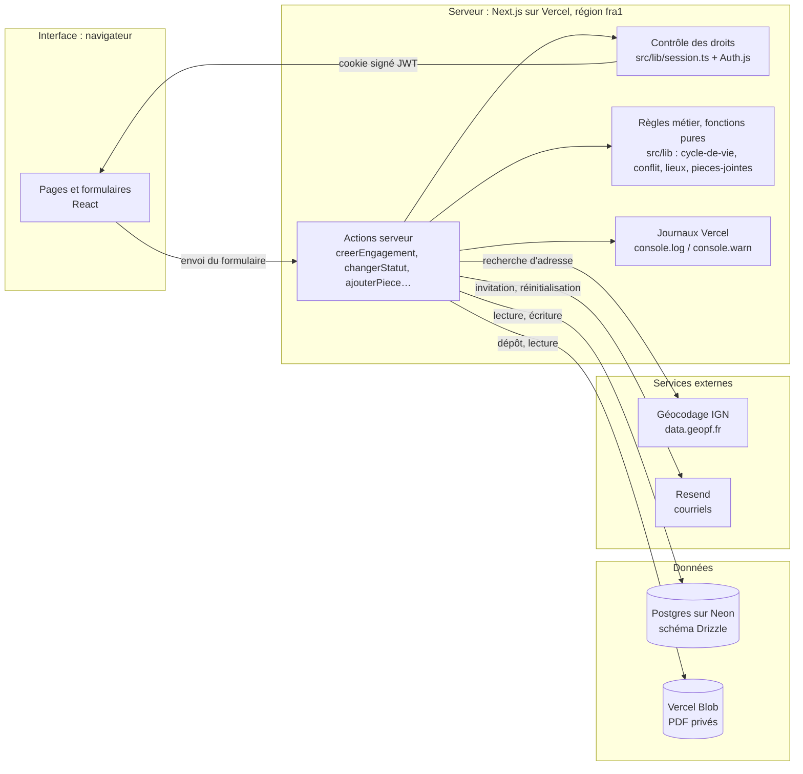
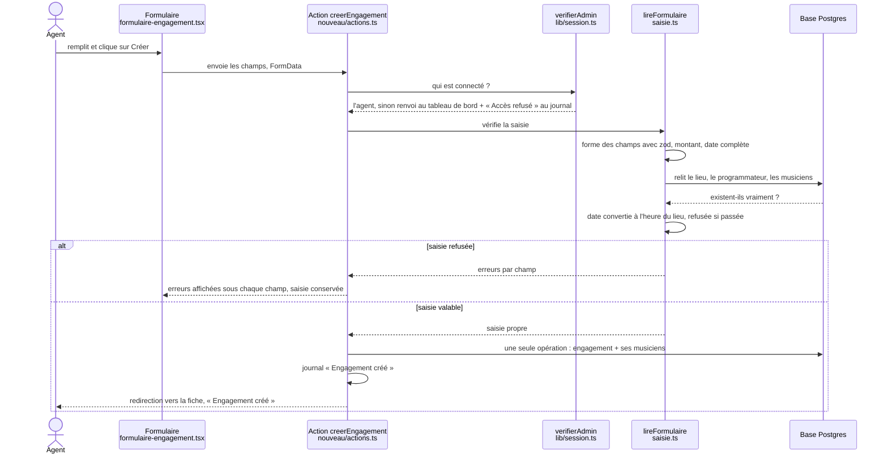

# Agence-musiciens

Outil interne d'une agence qui place des musiciens classiques en concert. L'**agent** (administrateur) invite les
musiciens, crée et suit les engagements (dates, lieux, cachets, contrats en PDF) ; chaque **musicien** voit
seulement ses propres engagements, sans pouvoir les modifier.

En ligne : https://agence-musiciens.vercel.app — toutes les données sont fictives.

Documents du projet : `SPEC.md` (ce qu'on construit), `SUIVI.md` (où on en est), `AGENTS.md` (conventions),
`docs/engagements.md` (règles des engagements), `docs/securite.md` (revue de sécurité).

## Ce que fait le produit

- **Comptes** : premier compte agent (`/installation`), invitation des musiciens par lien, connexion,
  mot de passe oublié.
- **Engagements** : liste filtrable, fiche, création, modification, cycle de vie
  (option → contrat envoyé → confirmé → joué, ou annulé puis rétabli).
- **Lieux** : adresse vérifiée par le géocodage de l'IGN (coordonnées GPS enregistrées).
- **Conflits d'agenda** : un musicien ne peut pas être confirmé à deux concerts trop proches (trajet estimé),
  sauf raison écrite par l'agent.
- **Pièces jointes** : PDF de 4 Mo au plus, servis seulement aux personnes qui ont droit à l'engagement.

## Schéma du produit

Quatre couches : l'**interface** (le navigateur), le **serveur** (Next.js sur Vercel), les **données**
(Postgres sur Neon, fichiers sur Vercel Blob) et les **services externes**.

### Trajet d'une création d'engagement

Du clic sur « Créer » jusqu'à la base de données :

Idée centrale : **le serveur ne croit jamais le navigateur sur parole**, ni sur qui il est, ni sur ce qu'il envoie.

1. **Les droits.** Une action serveur est une adresse appelable depuis l'extérieur : un musicien sans bouton
   « Créer » peut quand même l'appeler (avec `curl`, par exemple). Cacher le bouton ne protège rien ; c'est
   `verifierAdmin` qui protège. Il lit le cookie de session, contrôle sa signature, puis exige le rôle `admin`.
   Sinon, renvoi au tableau de bord et « Accès refusé : Louis (musicien) sur … » au journal : ce n'est pas une
   connexion ratée (Louis est connecté) mais un refus d'accès, qui dit qui a tenté quoi.
2. **La relecture.** Le formulaire envoie des **identifiants** (lieu, programmateur, musiciens). Le serveur les
   relit en base, car le navigateur peut envoyer un identifiant inventé, celui d'une personne qui n'est pas
   musicienne, ou d'un lieu supprimé entre-temps. La base refuserait un lieu inexistant, mais par une erreur brute ;
   la relecture donne un message clair sous le bon champ, applique les règles que la base ignore (« être
   musicien ») et fournit le pays du lieu, nécessaire pour lire la date à l'heure locale.
3. **Le refus.** Toutes les erreurs s'affichent ensemble, chacune sous son champ ; la saisie est conservée ;
   rien n'est écrit en base ; le refus est noté au journal. (Le refus pour conflit d'agenda est un autre trajet :
   il arrive à la confirmation, sur la fiche, pas à la création.)
4. **L'enregistrement.** L'engagement et la liste de ses musiciens sont écrits en **une seule opération**
   (`db.batch`), dite **atomique** : tout ou rien. Écrits l'un après l'autre, une coupure entre les deux laisserait
   un engagement sans musicien, invisible pour eux et ignoré par la règle de conflit.

## Organisation du code

| Dossier | Contenu |
|---|---|
| `src/app/` | Pages et actions serveur, un dossier par adresse (`engagements/nouveau`, `invitation/[jeton]`…) |
| `src/lib/` | Règles métier et outils : droits, cycle de vie, conflits, géocodage, dates, argent, courriels |
| `src/db/` | Schéma de la base (`schema.ts`) et connexion |
| `src/components/` | Composants d'interface (shadcn/ui) |
| `drizzle/` | Migrations SQL, jouées à chaque déploiement |
| `scripts/` | Jeu de données fictives |
| `docs/` | Cadrage et revue de sécurité |

## Variables d'environnement

Elles vivent dans Vercel (Settings → Environment Variables), jamais dans le dépôt.

| Nom | Rôle |
|---|---|
| `DATABASE_URL` | Connexion à la base utilisée par l'application (mutualisée) |
| `DATABASE_URL_UNPOOLED` | Connexion directe, pour les migrations et le jeu de données |
| `AUTH_SECRET` | Signe le cookie de session |
| `RESEND_API_KEY` | Envoi des courriels (sans elle, le courriel est seulement noté au journal) |
| `BLOB_READ_WRITE_TOKEN` | Accès au stockage des PDF |
| `MOT_DE_PASSE_DEMO` | Mot de passe des comptes fictifs du jeu de données (12 caractères au moins) |

Fournies par Vercel : `VERCEL_ENV`, `VERCEL_BRANCH_URL`, `VERCEL_PROJECT_PRODUCTION_URL` (adresse des liens
envoyés par courriel). Pour travailler sur sa machine : `vercel env pull .env.local`.

## Commandes

| Commande | Ce qu'elle fait |
|---|---|
| `npm install` | Installe les dépendances |
| `npm run dev` | Lance le site sur http://localhost:3000 |
| `npm test` | Joue les tests automatiques (Vitest) |
| `npm run lint` | Vérifie le style du code (ESLint) |
| `npm run build` | Construit le site comme en production |
| `npx drizzle-kit generate --name <nom>` | Crée une migration après une modification de `src/db/schema.ts` |
| `npm run donnees` | Recharge le jeu de données fictives (voir ci-dessous) |

À chaque push, GitHub Actions rejoue lint, tests et construction.

## Déploiement et rechargement des données

- Chaque branche a sa **prévisualisation** Vercel et sa propre branche de base Neon ; `main` est la production.
- Au déploiement, `vercel-build` joue les migrations, puis, **sur une prévisualisation seulement**, recharge le
  jeu de données fictives : les essais faits à la main sont effacés au push suivant.
- `npm run donnees` remplit la base désignée par `DATABASE_URL_UNPOOLED`. Les identifiants fictifs sont fixes :
  sessions et adresses des fiches restent valables après un rechargement. Le compte de l'agent n'est pas touché.
  Les fichiers PDF déjà déposés ne sont pas effacés du stockage.
- Les portraits des musiciens fictifs (`scripts/portraits/`) sont envoyés au stockage privé par le jeu de données, à
  des chemins fixes remplacés à chaque rechargement. **Ce sont des photos de banques d'images** (filigranes visibles),
  gardées pour la démonstration par décision de l'auteur : à remplacer par des portraits générés avant tout usage réel.
