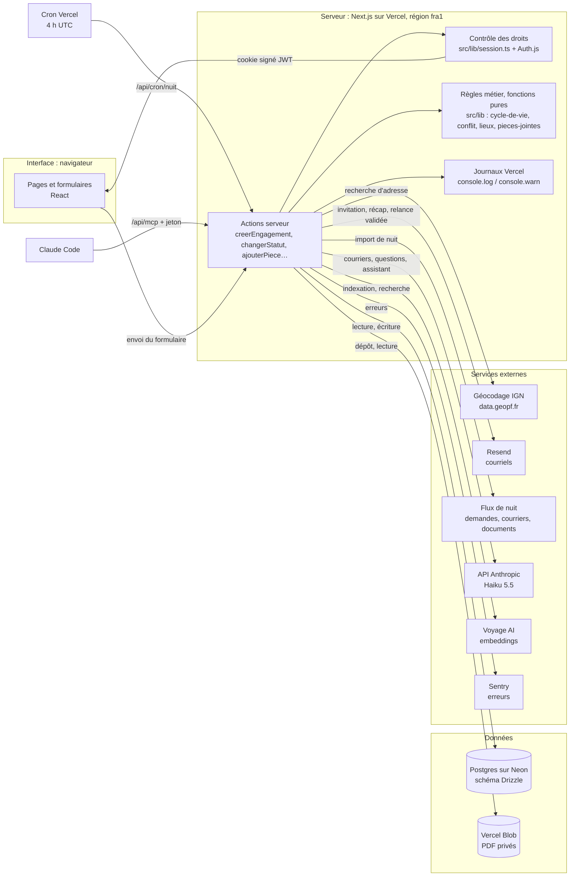
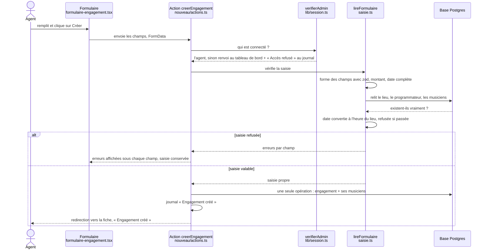

# Agence-musiciens

Outil interne d'une agence qui place des musiciens classiques en concert. L'**agent** (administrateur) invite les
musiciens, crée et suit les engagements (dates, lieux, cachets, contrats en PDF) ; chaque **musicien** voit
seulement ses propres engagements, sans pouvoir les modifier. Chaque nuit, le produit importe les demandes reçues ;
l'IA lit les courriers et répond aux questions sur les documents ; un assistant prépare les relances, que l'agent
valide avant tout envoi.

En ligne : https://agence-musiciens.vercel.app — toutes les données sont fictives.

**Pour reprendre le projet** : lire ce README (dont « Lancer en dix minutes » et « Inventaire des clés »), puis
`AGENTS.md` (conventions, à suivre par l'humain comme par l'IA), `SPEC.md` (ce qu'on construit) et `SUIVI.md` (où on
en est). Les autres documents sont dans `docs/` :

| Document | Contenu |
|---|---|
| `docs/engagements.md` | Règles des engagements : cycle de vie, droits, conflits d'agenda |
| `docs/securite.md` | Revue de sécurité |
| `docs/flux-de-nuit.md` | Semaine 2 : import de nuit, récap du matin, surveillance |
| `docs/semaine-3.md`, `docs/ia.html` | Semaine 3 : fonctions IA, erreurs visibles, coûts |
| `docs/semaine-4.md` | Semaine 4 : mission de l'assistant (outils, budget, validation) |
| `docs/scenarios-agent.md`, `docs/rendus-semaine-4.md` | Semaine 4 : 20 scénarios, dérives, garde-fous, coût |

## Ce que fait le produit

- **Comptes** : premier compte agent (`/installation`), invitation des musiciens par lien, connexion,
  mot de passe oublié.
- **Engagements** : liste filtrable, fiche, création, modification, cycle de vie
  (option → contrat envoyé → confirmé → joué, ou annulé puis rétabli).
- **Lieux** : adresse vérifiée par le géocodage de l'IGN (coordonnées GPS enregistrées).
- **Conflits d'agenda** : un musicien ne peut pas être confirmé à deux concerts trop proches (trajet estimé),
  sauf raison écrite par l'agent.
- **Pièces jointes** : PDF de 4 Mo au plus, servis seulement aux personnes qui ont droit à l'engagement.
- **Nuit** (semaine 2) : chaque nuit à 4 h (UTC), import des événements du flux de nuit dans « Demandes reçues »
  (rejouable sans doublon), journal des exécutions sur `/nuit`, récap du matin par courriel, alerte si l'import
  tombe, sonde UptimeRobot sur `/api/sante`, erreurs suivies par Sentry.
- **IA** (semaine 3) : lecture d'un courrier déposé (champs remplis, à relire), questions sur les documents avec la
  page citée (`/questions`), analyse de la nuit ; coûts, limites et plafond sur `/couts`.
- **Assistant** (semaine 4) : `/assistant` lit les données, ajoute une note, crée un engagement depuis une demande,
  et **propose** des relances qui attendent sur « À valider » (`/validations`) ; rien ne part sans clic de l'agent.
  Les mêmes outils sont offerts à Claude Code par le serveur MCP `/api/mcp`, protégé par un jeton.

## Schéma du produit

Quatre couches : l'**interface** (le navigateur), le **serveur** (Next.js sur Vercel), les **données**
(Postgres sur Neon, fichiers sur Vercel Blob) et les **services externes**.



Le schéma de la semaine 1 parle d'« actions » pour tout le serveur : ce sont aussi les routes `src/app/api/` (cron,
assistant, MCP, questions, sonde). UptimeRobot, hors schéma, interroge `/api/sante` toutes les 5 minutes.

### Trajet d'une création d'engagement

Du clic sur « Créer » jusqu'à la base de données :



Idée centrale : **le serveur ne croit jamais le navigateur sur parole**, ni sur qui il est, ni sur ce qu'il envoie.

1. **Les droits.** Une action serveur est une adresse appelable depuis l'extérieur : un musicien sans bouton
   « Créer » peut quand même l'appeler (avec `curl`, par exemple). Cacher le bouton ne protège rien ; c'est
   `verifierAdmin` qui protège. Il lit le cookie de session, contrôle sa signature, puis exige le rôle `admin`.
   Sinon, renvoi au tableau de bord et « Accès refusé : Louis (musicien) sur … » au journal : ce n'est pas une
   connexion ratée (Louis est connecté) mais un refus d'accès, qui dit qui a tenté quoi.
2. **La relecture.** Le formulaire envoie des **identifiants** (lieu, programmateur, musiciens). Le serveur les
   relit en base, car le navigateur peut envoyer un identifiant inventé, celui d'une personne qui n'est pas
   musicienne, ou d'un lieu supprimé entre-temps. La base refuserait un lieu inexistant, mais par une erreur brute ;
   la relecture donne un message clair sous le bon champ, applique les règles que la base ignore (« être
   musicien ») et fournit le pays du lieu, nécessaire pour lire la date à l'heure locale.
3. **Le refus.** Toutes les erreurs s'affichent ensemble, chacune sous son champ ; la saisie est conservée ;
   rien n'est écrit en base ; le refus est noté au journal. (Le refus pour conflit d'agenda est un autre trajet :
   il arrive à la confirmation, sur la fiche, pas à la création.)
4. **L'enregistrement.** L'engagement et la liste de ses musiciens sont écrits en **une seule opération**
   (`db.batch`), dite **atomique** : tout ou rien. Écrits l'un après l'autre, une coupure entre les deux laisserait
   un engagement sans musicien, invisible pour eux et ignoré par la règle de conflit.

## Organisation du code

| Dossier | Contenu |
|---|---|
| `src/app/` | Pages et actions serveur, un dossier par adresse (`engagements/nouveau`, `invitation/[jeton]`…) |
| `src/lib/` | Règles métier et outils : droits, cycle de vie, conflits, géocodage, dates, argent, courriels |
| `src/db/` | Schéma de la base (`schema.ts`) et connexion |
| `src/components/` | Composants d'interface (shadcn/ui) |
| `src/app/api/` | Routes appelées sans page : cron de nuit, assistant (streaming), MCP, questions, sonde de santé |
| `drizzle/` | Migrations SQL, jouées à chaque déploiement |
| `scripts/` | Jeu de données fictives ; `scenarios-agent.ts` (rejoue les 20 scénarios de l'assistant) |
| `docs/` | Cadrage de chaque semaine, revue de sécurité, scénarios |

L'assistant tient en trois fichiers : `src/lib/agent.ts` (le moteur : SDK d'agents, budget, verrou, journal),
`src/lib/agent-outils.ts` (les 10 outils, avec rôle, budget d'appels et budget MCP revérifiés à chaque appel) et
`src/lib/agent-regles.ts` (règles pures, testées).

## Inventaire des clés

Toutes les clés vivent dans Vercel (Settings → Environment Variables, en Production et en Preview), **jamais dans le
dépôt, le navigateur ni le chat**. Après un changement de clé, il faut redéployer (Deployments → ⋯ → Redeploy) : une
fonction déjà en ligne garde l'ancienne valeur.

| Nom | À quoi elle sert | D'où elle vient, comment la remplacer | Sans elle |
|---|---|---|---|
| `DATABASE_URL` | Connexion à la base, utilisée par le site | Intégration Neon de Vercel (une branche de base par prévisualisation) ; Neon → Connect | Le site ne démarre pas |
| `DATABASE_URL_UNPOOLED` | Connexion directe : migrations et jeu de données | Idem | Pas de migration, pas de déploiement |
| `AUTH_SECRET` | Signe le cookie de session | `openssl rand -base64 32` ; la changer déconnecte tout le monde | Connexion impossible |
| `MOT_DE_PASSE_DEMO` | Mot de passe des comptes fictifs (12 caractères au moins) | Choisi par l'auteur | Jeu de données refusé |
| `RESEND_API_KEY` | Courriels : invitations, mot de passe oublié, récap, alerte, relances validées | resend.com → API Keys | Courriel seulement noté au journal ; lien d'invitation affiché à l'agent |
| `BLOB_STORE_ID` (+ `VERCEL_OIDC_TOKEN`, fourni par Vercel) ou `BLOB_READ_WRITE_TOKEN` | Stockage privé des PDF et des photos | Vercel → Storage → Blob, relié au projet | Pas de pièce jointe ; musiciens sans photo |
| `FLUX_DE_NUIT_CLE` | Import de nuit, courriers et documents du flux | flux-de-nuit.vercel.app, page d'accueil (prénom) | L'import de nuit échoue (journal sur `/nuit`, alerte) |
| `CRON_SECRET` | Seul le cron de Vercel peut lancer l'import de nuit | `openssl rand -hex 32` ; Vercel l'envoie seul à chaque cron | `/api/cron/nuit` refuse tout |
| `ANTHROPIC_API_KEY` | Modèles Claude : courriers, questions, analyse de nuit, assistant | console.anthropic.com → API Keys, avec une limite de dépense | Fonctions IA en erreur, message à l'écran |
| `VOYAGE_API_KEY` | Embeddings : indexation des documents et recherche | dash.voyageai.com | Questions sur les documents impossibles |
| `SENTRY_DSN` | Envoi des erreurs à Sentry | sentry.io → projet → Client Keys (DSN) | Erreurs seulement dans les journaux Vercel |
| `MCP_JETON` | Jeton du serveur MCP : `Authorization: Bearer <jeton>` (32 caractères au moins) | `openssl rand -hex 32` ; le remplacer aussi dans Claude Code (voir plus bas) | `/api/mcp` refuse tout (401) |

Fournies par Vercel, rien à faire : `VERCEL_ENV`, `VERCEL_BRANCH_URL`, `VERCEL_PROJECT_PRODUCTION_URL` (adresse des
liens envoyés par courriel), `VERCEL_OIDC_TOKEN`.

**Secrets hors des variables du projet** :

- **Protection des prévisualisations** : Vercel demande une connexion pour ouvrir une prévisualisation. Un script ou
  Claude Code passe avec le secret « Protection Bypass for Automation » (Settings → Deployment Protection), donné dans
  l'adresse (`?x-vercel-protection-bypass=…`). On le remplace au même endroit (« Regenerate »). La production n'est
  pas protégée.
- **Claude Code** garde le jeton MCP dans sa configuration personnelle (hors du dépôt). Pour brancher le serveur,
  dans un terminal à part (le jeton copié dans le presse-papiers) :
  `JETON=$(pbpaste)` puis
  `claude mcp add --transport http cm-management "https://agence-musiciens.vercel.app/api/mcp" --header "Authorization: Bearer $JETON"`.
  Pour changer de jeton : `claude mcp remove cm-management`, puis la même commande.
- **Les comptes de service** (GitHub, Vercel, Neon, Resend, Anthropic, Voyage, Sentry, UptimeRobot) appartiennent à
  l'auteur. Un repreneur crée les siens et y range ses propres clés : aucune clé ne se transmet.

## Lancer en dix minutes

Pour faire tourner le produit sur sa machine, avec sa propre base. Il faut Node 24 et un compte Neon gratuit.

1. **Le code** : `git clone https://github.com/ValentinWIA/agence-musiciens.git`, puis `cd agence-musiciens` et
   `npm ci` (installe exactement les versions du dépôt).
2. **La base** : sur neon.tech, créer un projet (région Francfort). Copier deux adresses de connexion (bouton
   « Connect ») : celle avec « Connection pooling » activé, puis celle sans.
3. **Les clés** : créer à la racine un fichier `.env.local` (ignoré par Git, il ne part jamais sur GitHub) :
   ```
   DATABASE_URL=<adresse avec pooling>
   DATABASE_URL_UNPOOLED=<adresse sans pooling>
   AUTH_SECRET=<résultat de : openssl rand -base64 32>
   MOT_DE_PASSE_DEMO=<12 caractères au moins>
   ```
   Ces quatre clés suffisent pour les comptes, les engagements et les conflits. Les autres (tableau ci-dessus)
   allument chacune une fonction ; sans elles, le produit le dit à l'écran ou au journal au lieu de planter.
4. **Les tables** : `node --env-file=.env.local node_modules/drizzle-kit/bin.cjs migrate` crée les tables dans la
   base (toutes les migrations de `drizzle/`). `--env-file` fait lire `.env.local` : `npx drizzle-kit migrate` seul
   ne le lit pas et répond « url: undefined ».
5. **Le site** : `npm run dev` (lui lit `.env.local` tout seul), puis ouvrir http://localhost:3000/installation et
   créer le compte de l'agent. L'installation n'est possible que tant que la base n'a **aucun** compte : la faire
   avant l'étape 6.
6. **Les données fictives** : dans un second terminal, `npx tsx --env-file=.env.local scripts/jeu-de-donnees.ts`
   (4 musiciens, lieux, programmateurs, engagements ; comptes fictifs en `@agence-musiciens.test` avec
   `MOT_DE_PASSE_DEMO` ; sans stockage Blob, musiciens sans photo). Recharger la page.
7. **Vérifier** : `npm test` (376 tests, une seconde ; ils ne touchent pas la base et ne demandent aucune clé).

`npm ci` signale des « install scripts » non approuvés (esbuild, fsevents, unrs-resolver) : sans effet, les tests et
la construction passent. Si `npm run build` s'arrête sur « SecurityFatalError », Next.js a une faille connue : le
mettre à jour (`npm audit` dit vers quelle version), sur une branche à part.

Pour une **copie en ligne**, à son nom : importer le dépôt dans Vercel (région `fra1`), ajouter l'intégration Neon
et le stockage Blob depuis l'onglet Storage, ranger les autres clés, déployer. Les migrations sont jouées par
`vercel-build` ; ouvrir `/installation` sur l'adresse de production ; le cron est déclaré dans `vercel.json`.

## Commandes

| Commande | Ce qu'elle fait |
|---|---|
| `npm install` | Installe les dépendances |
| `npm run dev` | Lance le site sur http://localhost:3000 |
| `npm test` | Joue les tests automatiques (Vitest) |
| `npm run lint` | Vérifie le style du code (ESLint) |
| `npm run build` | Construit le site comme en production |
| `npx drizzle-kit generate --name <nom>` | Crée une migration après une modification de `src/db/schema.ts` |
| `npm run donnees` | Recharge le jeu de données fictives (voir ci-dessous) ; sur sa machine : `npx tsx --env-file=.env.local scripts/jeu-de-donnees.ts` |
| `node --env-file=.env.local node_modules/drizzle-kit/bin.cjs migrate` | Joue les migrations sur la base de `DATABASE_URL_UNPOOLED` (fait seul au déploiement) |
| `npx tsx scripts/scenarios-agent.ts` | Rejoue les 20 scénarios de l'assistant sur une prévisualisation (variables en tête du script) |

À chaque push, GitHub Actions rejoue lint, tests et construction.

## Déploiement et rechargement des données

- Chaque branche a sa **prévisualisation** Vercel et sa propre branche de base Neon ; `main` est la production.
- Au déploiement, `vercel-build` joue les migrations, puis, **sur une prévisualisation seulement**, recharge le
  jeu de données fictives : les essais faits à la main sont effacés au push suivant.
- `npm run donnees` remplit la base désignée par `DATABASE_URL_UNPOOLED`. Les identifiants fictifs sont fixes :
  sessions et adresses des fiches restent valables après un rechargement. Le compte de l'agent n'est pas touché.
  Les fichiers PDF déjà déposés ne sont pas effacés du stockage.
- Les portraits des musiciens fictifs (`scripts/portraits/`) sont envoyés au stockage privé par le jeu de données, à
  des chemins fixes remplacés à chaque rechargement. **Ce sont des photos de banques d'images** (filigranes visibles),
  gardées pour la démonstration par décision de l'auteur : à remplacer par des portraits générés avant tout usage réel.
